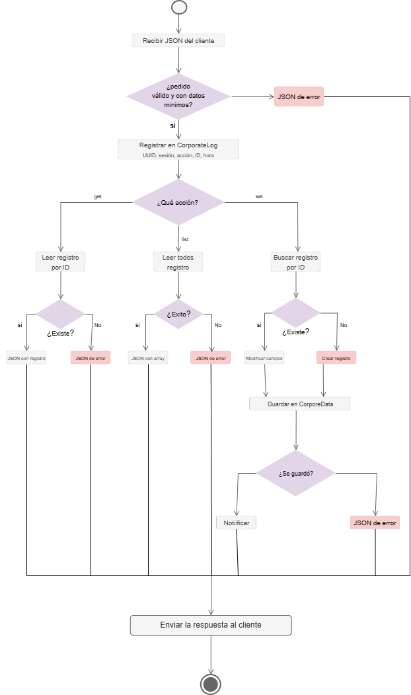
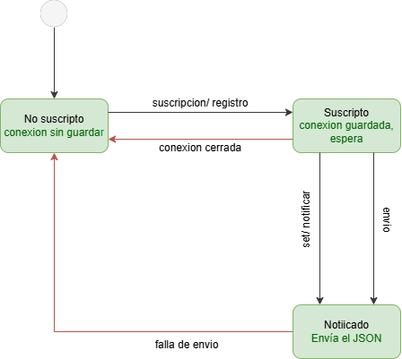

# Diagramas UML

Estas imágenes describen los flujos de diseño; no son capturas de una prueba
AWS. Para ejecutar los componentes, véanse las [instrucciones de uso](usage.md)
y el [informe de implementación](informe_tpfi.md).

## Actividad: Proxy

El Proxy recibe una operación, valida sus campos, audita la solicitud y delega
el acceso al gateway de datos. Un `set` exitoso se notifica al Observer.

## Estados: Observer

El cliente observador se conecta, se suscribe, escucha actualizaciones NDJSON
y vuelve a intentar la suscripción cuando se interrumpe la conexión.

